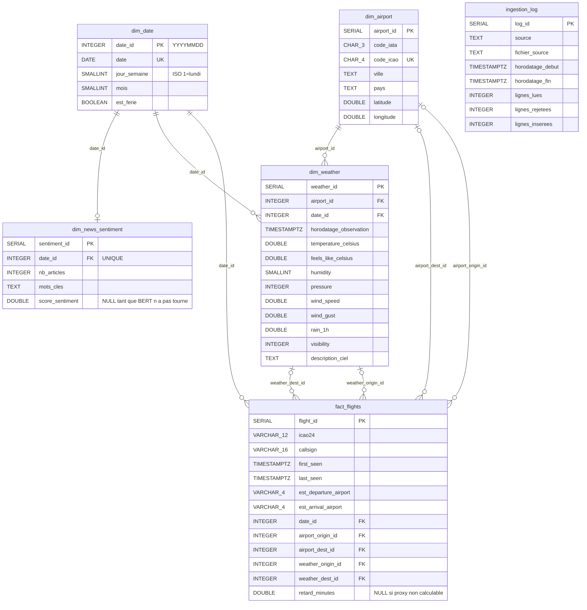

# ERD — schéma en étoile (Airlines Delay Prediction)

Source de vérité : `src/database/schema.sql` (tables réellement créées). 

**Grain de** `fact_flights` : un vol observé OpenSky `/flights/departure` ou `/flights/arrival` (`icao24` + `first_seen` + origine). Ce n'est **pas** un snapshot `/states/all`.

`dim_news_sentiment` se joint aux faits **via** `date_id` : il n'existe pas de FK `sentiment_id` sur `fact_flights`. `ingestion_log` est un journal technique, hors étoile.

## Fichiers

| Fichier                | Usage                                                         |
| ---------------------- | ------------------------------------------------------------- |
| `docs/erd_schema.dbml` | Source dbdiagram.io (PNG de soutenance)                       |
| `docs/erd_schema.md`   | Ce fichier : Mermaid + mode d'emploi                          |
| `docs/erd_schema.svg`  | Diagramme vectoriel versionnable, ouvrable dans un navigateur |

## Exporter un PNG ([dbdiagram.io](http://dbdiagram.io))

1. Ouvrir [https://dbdiagram.io](https://dbdiagram.io) (compte gratuit suffisant).
2. Nouveau diagramme, coller le contenu de `docs/erd_schema.dbml` (recharger si un ancien collage est encore ouvert).
3. Export → PNG (ou PDF). Enregistrer sous `docs/erd_schema.png`.

Opérateurs DBML 9+ (doc [relationships](https://dbml.dbdiagram.io/docs/#relationships)) : `>` many-to-one (FK NOT NULL), `>?` many-to-optional-one (FK nullable), `-` one-to-one (`date_id` UNIQUE sur `dim_news_sentiment`). Une seule `Ref` par couple, pas de `ref:` inline. Les NULL dest / météo / aéroport hors hubs restent volontaires dans Postgres ; ce n'est pas un défaut du schéma.

GitHub, GitLab et la plupart des visionneuses Markdown rendent aussi le bloc Mermaid ci-dessous.

