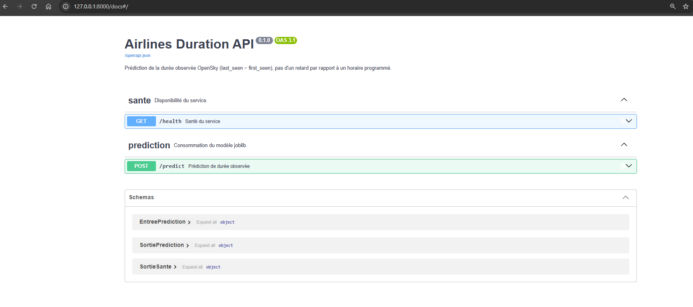
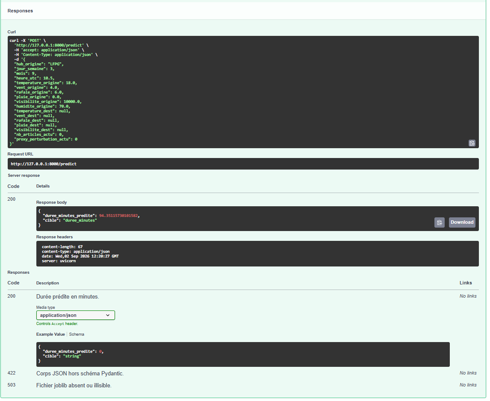
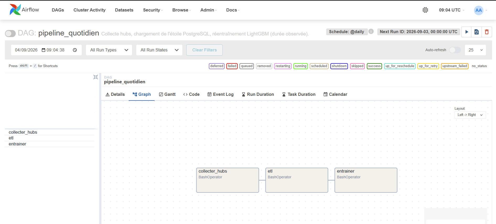
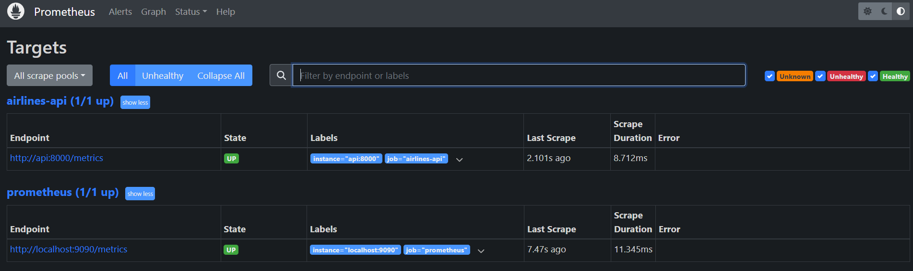
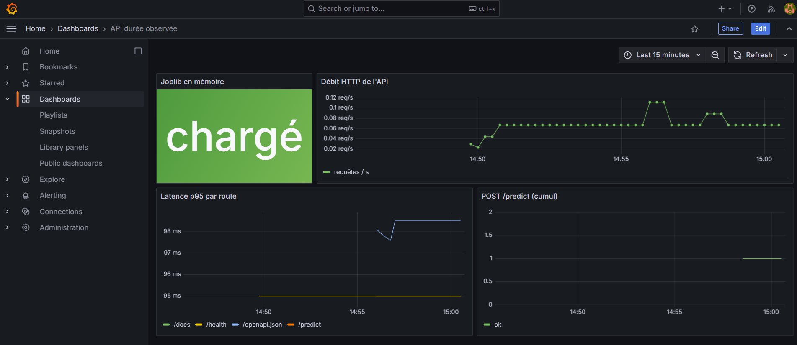
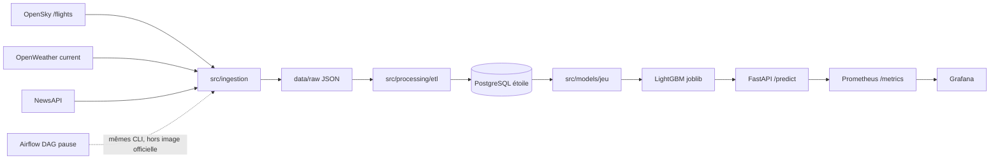

# Rapport final — Consommation, déploiement et automatisation

> **Projet** : Airlines Delay Prediction — Titre RNCP 38919 (Data Engineer)  
> **Statut** : Final

---

## 1. Synthèse des rendus précédents

| Livrable | Essentiel |
| --- | --- |
| **Rendu 1** | Trois APIs, cadrage IN/OUT, personas, KPI, veille, SWOT. Aucun horaire programmé → pas de retard « réel − prévu ». |
| **Rendu 2** | Étoile PostgreSQL, ETL incrémental. `retard_minutes` = proxy, pas un slot. Au 04/09 : **21 054** vols, **120** météos, **27** jours d'actu, **3 664** lignes modèle (~17 %). |
| **Rendu 3** | Cible retenue = **option B** (régression de la durée observée, pas un retard). LightGBM **54,02** vs médiane **44,07**. BERT et Open-Meteo testés. |

---

## 2. Gestion du code et bonnes pratiques

- **Dépôt** : [https://github.com/Jemaveh/flight-delay-prediction](https://github.com/Jemaveh/flight-delay-prediction)
- **Couches** : `src/ingestion`, `processing`, `database`, `models`, `api`, `utils`, `config` — une responsabilité par module, tests dans `tests/`.
- **Rejeu** : `README.md` (install, `.env.example`, commandes).
- **Pilotage** : projet solo ; suivi = journal de bord, Notion et Git. Feuille de route = table des phases du README. KPI / SWOT : Rendu 1.

**Livrables techniques**

- FastAPI : `/health`, `/predict`, `/metrics`, `/docs` (`joblib`)
- Grafana : scrape de l'API
- CI GitHub Actions : `pytest`
- Airflow SequentialExecutor, DAG **en pause**

---

## 3. Déploiement

**Compose v2**, trois profils qui ne se cumulent pas sur 8 Go : `api` | `monitoring` (API + Prometheus + Grafana) | `airflow`.

- Image API : `python:3.11.9-slim-bookworm` (pas `latest`), `requirements-api.txt` (sans torch).
- `joblib` monté depuis `./models` (gitignoré). Secrets : `env_file: .env`, hors image.
- Postgres **métier** = instance Windows Phase 2. Airflow a sa propre métabase (`airflow-db`).
- SequentialExecutor : DAG linéaire. Pas de `airflow standalone` (SQLite / verrou Windows).

**DevOps** : `.dockerignore` (`.env`, `data/`, `venv/`) ; `healthcheck` sur `/health`.

### 3.1 API

| Endpoint | Méthode | Rôle |
| --- | --- | --- |
| `/health` | GET | Disponibilité + jauge joblib |
| `/metrics` | GET | Exposition Prometheus |
| `/predict` | POST | Durée observée prédite (`duree_minutes`) |
| `/docs` | GET | OpenAPI native |

*Figure 1 — `/docs` : contrat = durée OpenSky, pas un écart à un horaire.*

*Figure 2 — `POST /predict` consomme le `joblib` et renvoie `duree_minutes`.*

### 3.2 Démo vs production

C'est une **démo reproductible**, pas un 24/7.

| | Démo (livrée) | Production (non appliquée, partie 3.4) |
| --- | --- | --- |
| API + Grafana | Profils `api` / `monitoring` | Même graphe, hôte dédié |
| Airflow | UI / CLI, DAG **en pause** | Un Trigger = collecte + ETL + entraînement |
| Collecte OpenSky | Scripts venv | Image `Dockerfile.airflow` + `src/` monté |

Un Trigger n'est **pas** la démo de collecte. Profils `api` et `airflow` ne tournent pas ensemble sur mon PC perso.

### 3.3 Rôle actuel d'Airflow

Airflow **orchestre** les CLI déjà écrits (`collecter_hubs` → `etl` → `entrainer`). NewsAPI n'est pas dans le DAG.

- Image officielle : seul `dags/` est monté → `python -m src...` ne peut pas s'exécuter dans le conteneur.
- `DATABASE_URL` en `localhost` depuis Docker ≠ Postgres Windows.
- Pause à la création : pas de salve automatique au `up`.
- Collecte réelle = venv, une salve, quota maîtrisé.

*Figure 3 — `pipeline_quotidien` : trois tâches, NewsAPI absente, DAG en pause.*

### 3.4 Bascule production : un Trigger = collecte + ETL + entraînement

**But.** Airflow lance le batch quotidien. Un Trigger exécute `collecter_hubs` → `etl` → `entrainer`. L'API et Grafana restent des services à part : Airflow ne les démarre pas.

**Non appliquée** sur le PC 8 Go, pour deux raisons distinctes.

1. **Scripts absents du conteneur.** Le DAG `pipeline_quotidien` existe déjà (figure 3). Chaque tâche fait `python -m src...`. L'image officielle ne monte que `dags/` : le graphe est visible, pas le dossier `src/`. Un Trigger échoue (module introuvable). Ce n'est pas un DAG manquant.

2. **RAM.** Les profils Compose `monitoring` (API + Prometheus + Grafana) et `airflow` (métabase + webserver + scheduler) ne se lancent pas ensemble. Même sur l'hôte dédié : les deux usages (servir et orchestrer) sont prévus, pas les deux profils dans le même `up`.

| | Démo (livrée) | Cible (machine dédiée, ≥ 16 Go) |
| --- | --- | --- |
| Image Airflow | `apache/airflow:2.10.4-python3.11`, volume `dags/` seul | `Dockerfile.airflow` + volumes `src/`, `config/`, `data/raw/`, `models/` |
| Entrepôt | `DATABASE_URL` = Postgres Windows (`localhost`) | `DATABASE_URL_CONTENEUR` via `host.docker.internal` (pas `airflow-db`) |
| Collecte | scripts venv (hors Airflow) | **un** Trigger Airflow par jour (quota OpenSky) |
| API / Grafana | profil `monitoring`, sans le profil `airflow` | mêmes services, **autre** `up` que celui d'Airflow |

| Hôte | RAM | Rôle |
| --- | --- | --- |
| PC perso | 8 Go | UI Airflow, DAG en pause ; collecte = venv |
| VM test | ~3,7 Go, sans swap | Preuve CLI du graphe ; pas d'UI Gunicorn fiable |
| Machine dédiée | ≥ 16 Go | Cible : API (et Grafana) **et** un Trigger Airflow, profils Compose séparés |

Sur la machine cible : construire `Dockerfile.airflow` (tag 2.10.4, `libgomp1`, `requirements-airflow.txt`) ; monter `src/` (et `config/`, `data/raw/`, `models/`) ; pointer le scheduler vers l'étoile métier ; **un** Trigger ; contrôler `fact_flights` puis `/predict` (recharger le `joblib`). Retour arrière : image officielle + `dags/` seul. Kubernetes n'est pas requis.

---

## 4. Automatisation et monitoring

L'orchestration (horloge, graphe, pourquoi un Trigger échoue aujourd'hui, comment le débloquer) est en parties 3.3 et 3.4. Dans cette partie : la CI et le monitoring du **service**.

**CI** : GitHub Actions (`tests.yml`) lance `pytest` avec `requirements-ci.txt` (sans torch). `.env` recopié depuis `.env.example` : **aucun secret**. Tests Postgres ignorés si la base n'est pas là. Pas de lint ni de `docker build` dans Actions.

**Monitoring** : logs (`logger.py` + `ingestion_log`) ; Prometheus scrape `api:8000` ; Grafana provisionné (joblib, débit, p95, cumul `/predict`). Rétention 24 h.

*Figure 4 — Prometheus : job `airlines-api` UP.*

*Figure 5 — Grafana : santé de l'API, pas une carte d'avions.*

**KPI suivis** : `pytest` vert sur `main` ; jauge joblib / p95 ; crédits OpenSky dans les logs ; DAG en pause.

---

## 5. Bilan et suite

**Difficultés.** Titre « retard » vs contrat des APIs ; quota OpenSky ; météo *current* ± 3 h ; RAM (8 Go / 3,7 Go) ; LightGBM sous la médiane.

**Verrous.** Pas d'heure prévue dans les trois APIs ; image officielle Airflow sans `src/` ; OOM Gunicorn sur la VM.

**Livré.** Pipeline Europe reproductible, API de durée observée, CI, monitoring du service, DAG quotidien en pause.

**Ensuite.** Appliquer la partie 3.4 sur un hôte dédié.

---

## 6. Bibliographie

- OpenSky Network, *REST API* (`/flights/departure`, `/flights/arrival`, OAuth2) : https://openskynetwork.github.io/opensky-api/rest.html
- OpenWeather, *Current Weather Data* : https://openweathermap.org/current
- Open-Meteo, *Historical Weather API* : https://open-meteo.com/en/docs/historical-weather-api
- NewsAPI, *Everything* : https://newsapi.org/docs/endpoints/everything
- Microsoft, LightGBM : https://lightgbm.readthedocs.io/
- Hugging Face, DistilBERT sentiments : https://huggingface.co/lxyuan/distilbert-base-multilingual-cased-sentiments-student
- FastAPI : https://fastapi.tiangolo.com/
- Apache Airflow 2.10 : https://airflow.apache.org/docs/apache-airflow/2.10.4/index.html
- Prometheus / Grafana : https://prometheus.io/docs/introduction/overview/ ; https://grafana.com/docs/grafana/latest/
- US DOT / BTS (Kaggle — **non utilisé** dans `fact_flights`) : https://www.kaggle.com/datasets/usdot/flight-delays
- Règlement (CE) n° 261/2004 du Parlement européen et du Conseil du 11 février 2004 (indemnisation et assistance en cas de retard important) : https://eur-lex.europa.eu/legal-content/FR/TXT/?uri=CELEX:32004R0261 — le retard y est un écart à l'heure **prévue** ; hors contrat des trois APIs du projet.

---

## 7. Annexes

Sources → JSON → étoile → joblib → API. Airflow orchestre les CLI ; l'image officielle ne contient pas `src/`.

- **API consommées** : OpenSky `/flights/*`, OpenWeather `/data/2.5/weather`, NewsAPI `/v2/everything`.
- **Config** : `.env.example` + `config/settings.py`.
- **Figures** : 1–2 (partie 3.1), 3 (partie 3.3), 4–5 (partie 4) dans `docs/captures/`.
