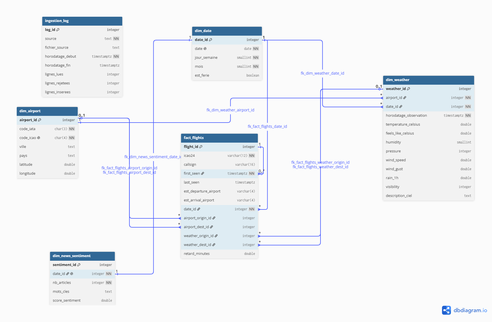
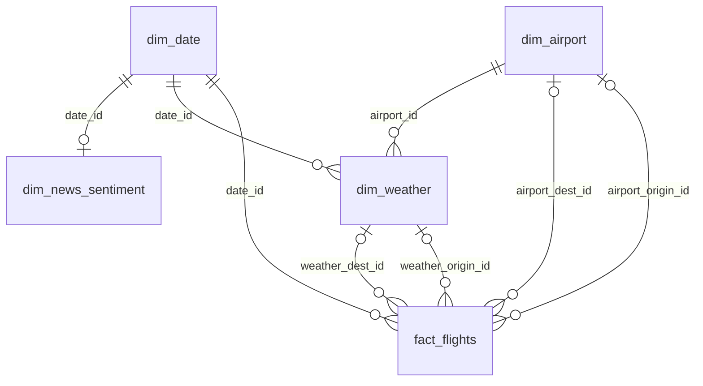

# Rendu 2 — Rapport d'organisation et de modélisation des données

> **Projet** : Airlines Delay Prediction — Titre RNCP 38919 (Data Engineer)
> **Statut** : Brouillon — ERD et ETL observés (seconde collecte multi-hubs)
> **Correspond à** : Phase 2 du projet — Organisation et modélisation des données

---

## 1. Architecture et stockage

### 1.1 Base de données choisie

**PostgreSQL** (système de gestion de base de données relationnel, client-serveur).

**Pourquoi PostgreSQL plutôt qu'une base embarquée ou une base NoSQL ?**
- **SGBD relationnel client-serveur mature et largement utilisé en entreprise** : PostgreSQL est un standard de l'industrie, avec un écosystème riche (extensions, outils d'administration, pilotes disponibles dans tous les langages), ce qui en fait un choix directement transférable à un contexte professionnel.
- **Gestion native de la concurrence d'accès** : contrairement à une base embarquée, PostgreSQL gère nativement plusieurs connexions simultanées en lecture et en écriture, ce qui correspond à un usage réaliste où le pipeline d'ingestion, l'API de prédiction et d'éventuels outils d'analyse accèdent à la base en parallèle.
- **Disponible en local sans imposer le docker-compose applicatif** : en Phase 2, une instance PostgreSQL locale suffit (installation Windows, ou un conteneur `postgres:16` lancé isolément). Le `docker-compose` qui orchestre pipeline, API et base relève de la Phase 4 : je ne le fais pas entrer dans l'architecture de cette phase sous prétexte qu'une image officielle existe.
- **Compatibilité avec SQLAlchemy** : l'utilisation d'un toolkit SQL standard (SQLAlchemy) au-dessus de PostgreSQL facilite l'écriture de requêtes portables et la maintenance du code d'accès aux données.
- MongoDB (NoSQL document) a été écarté : mes données sont structurées et relationnelles par nature (un vol a une météo et un contexte d'actualité associés à une date/aéroport) — un modèle relationnel est plus adapté qu'un stockage document flexible dont on n'a pas l'usage ici.

Une base de données analytique embarquée (de type DuckDB) aurait également constitué un choix technique valide pour le volume de données de ce projet, notamment pour sa simplicité de mise en œuvre sans serveur dédié. PostgreSQL a été retenu à la place afin de démontrer une compétence de gestion de base de données client-serveur (connexion réseau, gestion de la concurrence), plus représentative des architectures rencontrées en environnement de production. La conteneurisation de cette instance, elle, n'est pas un prérequis de la Phase 2.

### 1.2 Choix d'architecture : Schéma en étoile (Star Schema)

J'adopte un **schéma en étoile**, standard des Data Warehouses pour les cas d'usage analytiques/ML. `fact_flights` est au centre ; les dimensions tournent autour. Le grain de la table de faits est un vol observé OpenSky `/flights/departure` ou `/flights/arrival` — pas un snapshot `/states/all`.

Le schéma détaillé (colonnes, types, FK nommées) est versionné ici, aligné sur `src/database/schema.sql` :

- `docs/erd_schema.png` — export PNG dbdiagram.io (soutenance)
- `docs/erd_schema.dbml` — source à recoller sur [dbdiagram.io](https://dbdiagram.io) si le DDL bouge
- `docs/erd_schema.md` — diagramme Mermaid (rendu GitHub / visionneuse Markdown)
- `docs/erd_schema.svg` — diagramme vectoriel, ouvrable dans un navigateur

`dim_news_sentiment` n'a **pas** de FK `sentiment_id` sur `fact_flights` : la jointure se fait via `date_id`. `ingestion_log` est un journal technique, hors étoile.

**Pourquoi un schéma en étoile plutôt qu'une table unique, un flocon, un Data Lake ou une 3NF ?**

L'exploration de la Phase 1 a montré que mes trois sources n'ont **pas le même grain** :
- un **vol** OpenSky (`/flights/departure` et `/flights/arrival`) est un aéronef (`icao24`) + une paire origine/destination + une fenêtre `firstSeen` / `lastSeen` ;
- une **observation météo** OpenWeather est un hub + un instant ;
- un **article** NewsAPI n'a aucune clé vers un vol précis : le grain utile est le jour (après agrégation).

Une table unique collerait ces trois grains dans une même ligne. Je dupliquerais la météo sur chaque vol du même hub à la même heure, et je rattacherais un article à un vol sans jointure réelle — l'exploration n'a jamais produit cette clé. L'étoile garde chaque grain dans sa table et relie par des clés (`airport_id`, `date_id`, et pour la météo une FK d'observation, pas seulement le jour calendaire).

- **Vs. flocon (snowflake)** : le flocon normalise davantage les dimensions (ex : `dim_airport` éclatée en `dim_ville` + `dim_pays`), ce qui réduit la redondance mais complexifie les jointures. Vu le volume de mon projet (dix hubs, quelques milliers de vols, un signal d'actualité journalier), cette redondance est négligeable. Les requêtes restent simples, ce qui compte pour produire ensuite une table plate de features.
- **Vs. Data Lake brut (fichiers JSON/Parquet non modélisés)** : j'ai déjà cette zone (`data/raw/`). Elle assure la traçabilité et le rejeu, pas l'intégrité référentielle ni des clés stables pour le ML. L'étoile est l'entrepôt ; le lake n'en est pas un substitut.
- **Vs. MongoDB (documents)** : mes données sont tabulaires et je dois joindre. Un stockage document masquerait le problème de grain au lieu de le résoudre.
- **Vs. 3NF de type OLTP** : je n'ai pas de transactions métier (pas de réservation à mettre à jour). L'usage est analytique : lire, joindre, dériver des features. L'étoile est faite pour ça.

### 1.3 Table de faits et dimensions (détail)

| Table | Rôle | Colonnes clés (indicatif) |
|---|---|---|
| **fact_flights** | Table de faits — un enregistrement par vol observé (`/flights/*`, pas `/states/all`) | `flight_id`, `icao24`, `callsign`, `first_seen`, `last_seen`, `est_departure_airport`, `est_arrival_airport`, `date_id` (FK), `airport_origin_id` / `airport_dest_id` (FK, nullables hors hubs), `weather_origin_id` / `weather_dest_id` (FK, nullables), `retard_minutes` (nullable) |
| **dim_airport** | Dimension aéroport (IATA et ICAO : OpenWeather vs OpenSky) | `airport_id` (PK), `code_iata`, `code_icao` (UNIQUE), `ville`, `pays`, `latitude`, `longitude` |
| **dim_weather** | Dimension météo (rattachée à un hub + un instant UTC) | `weather_id` (PK), `airport_id` (FK), `date_id` (FK), `horodatage_observation`, température, `feels_like`, humidité, pression, vent, rafales, `rain_1h`, visibilité, `description_ciel` |
| **dim_news_sentiment** | Dimension sentiment des actualités (grain jour, même si le 1er modèle ML ne s'en sert pas) | `sentiment_id` (PK), `date_id` (FK), `nb_articles`, `mots_cles`, `score_sentiment` (NULL tant que BERT n'a pas tourné) |
| **dim_date** | Dimension temporelle (facilite les agrégations calendaires) | `date_id` (PK, YYYYMMDD), `date`, `jour_semaine`, `mois`, `est_ferie` |
| **ingestion_log** | Trace des chargements (rejeu / incrémental) | source, fichier, horodatages UTC, lignes lues / rejetées / insérées |

*(Le DDL est dans `src/database/schema.sql`. L'ERD détaillé est dans `docs/erd_schema.png`, `docs/erd_schema.dbml`, `docs/erd_schema.md` et `docs/erd_schema.svg`.)*

#### DDL as code

pgAdmin m'a servi à créer l'instance PostgreSQL locale et la base **vide** `airlines_db`. Les tables, clés et index ne sont pas cliqués dans l'interface : ils vivent dans `src/database/schema.sql`, appliqué par le connecteur (`executer_schema` dans `src/database/db_connector.py`). C'est du **DDL as code** : le même fichier recrée le schéma sur une autre machine, chez un binôme, ou plus tard dans un conteneur. pgAdmin inspecte ; il ne définit pas le contrat. L'ETL remplit ce contrat, il ne le remplace pas.

### 1.4 Comment les sources sont-elles reliées entre elles ?

Les sources se rejoignent par des clés, pas par une fusion « à plat » :

- Un vol (`fact_flights`) porte un aéroport d'origine et de destination (codes ICAO OpenSky) → jointure avec `dim_airport`, qui porte aussi le code IATA utilisé par OpenWeather. Hors des dix hubs, la FK aéroport reste nulle : c'est attendu.
- La météo (`dim_weather`) est rattachée à un hub et à un **instant UTC**. Je ne joins pas seulement sur `date_id` (une averse du matin n'est pas la météo d'un décollage du soir) : pour l'origine, l'observation la plus proche de `first_seen` ; pour la destination, la plus proche de `last_seen` ; écart maximal de **3 heures**. Au-delà, ou hors hub, `weather_*_id` est NULL. Ces taux **varient d'une collecte à l'autre** : premier chargement (26/08 matin, LFPG seul, météo du 25/08) **22/172** en origine, 0 en dest ; après collecte multi-hubs et une capture OpenWeather *current* dans la même session (26/08 ~14h56 UTC) **546/972 (56,2 %)** en origine, **9/972** en dest. Une météo « current » ne recouvre que les vols proches de l'instant de capture (règle 3 h), pas toute une fenêtre `/flights/*` de 24 h. Ce n'est pas un KPI du schéma ; le calage s'améliore en collectant plus souvent pendant la fenêtre, pas en changeant le modèle.
- Le sentiment (`dim_news_sentiment`) est agrégé par jour → jointure via `date_id`. Aucune clé article↔vol n'existe dans les sources ; je ne l'invente pas. La table est dans l'entrepôt même si le premier modèle ML (Phase 3) partira de vol + météo si le temps est compté. `score_sentiment` reste NULL tant que BERT n'a pas tourné.
- `retard_minutes` : OpenSky `/flights/*` n'expose pas d'horaire programmé. La colonne est nullable. Un proxy (durée observée vs médiane de la route) n'est calculé que s'il y a assez d'historique ; je n'invente pas un slot théorique type DGAC. Premier chargement : entièrement NULL. Après le second cycle : 11 vols avec proxy, 961/972 encore NULL (effectif de route souvent insuffisant, destinations souvent manquantes).

Pour un **retard d'horaire** (cible des projets Kaggle / du règlement 261/2004), il aurait fallu une **quatrième source** : un horaire publié, joint au vol. Un CSV BTS américain ne se verse pas dans `fact_flights` : autre pays, autre grain, autres colonnes. Il irait dans une table à part, ou on aurait choisi ce jeu **à la place** d'OpenSky dès le cadrage. Détail des trois chemins : Rendu 3, section « Ce qu'il aurait fallu pour prédire un retard ».

---

## 2. Documentation technique

### 2.1 Pipelines de données : ETL, code-based (Python)

Je choisis une approche **ETL code-based en Python** (par opposition à une approche déclarative type dbt/SQL) :

**Pourquoi Python plutôt que dbt ?**
- dbt est excellent pour transformer des données **déjà présentes dans un entrepôt SQL**. Ici, l'étape critique est l'**ingestion depuis des APIs externes hétérogènes** (JSON complexe, authentification, gestion d'erreurs réseau, appel à un modèle BERT) — un besoin procédural que Python gère nativement, alors que dbt n'est pas conçu pour appeler des APIs ou exécuter un modèle de NLP.
- Cohérence d'écosystème : un seul langage (Python) pour l'ingestion, la transformation ET le Machine Learning (Phase 3 interne), ce qui simplifie la maintenance pour un projet solo.

**Logique du pipeline** :
1. **Extract** (`src/ingestion/` + `src/processing/collecter_hubs.py`) : appel des APIs, boucle hubs × `/flights/departure|arrival` avec pause, sauvegarde brute horodatée dans `data/raw/` (traçabilité et possibilité de rejouer les transformations sans réinterroger les APIs). NewsAPI n'est pas rappelée à chaque cycle (corpus Rendu 1 déjà chargé).
2. **Transform** (`src/processing/`) : nettoyage (règles validées en Phase 1, adaptées au grain `/flights/*` pour les vols), normalisation, agrégation journalière des actualités. Le score BERT et le proxy de retard ne sont pas fabriqués « pour remplir la colonne » : `score_sentiment` et `retard_minutes` restent NULL tant que le calcul n'est pas défendable.
3. **Load** (`src/database/` + `src/processing/etl.py`) : écriture dans le schéma en étoile PostgreSQL, en upsert (`ON CONFLICT`) pour pouvoir relancer sans dupliquer. Ordre de chargement imposé par les FK : `dim_date` → `dim_airport` → `dim_weather` → `dim_news_sentiment` → `fact_flights`. Les faits référencent toutes les dimensions ; inverser l'ordre casserait les contraintes.

### 2.2 Outils, frameworks et technologies utilisés

| Catégorie | Outil | Justification courte |
|---|---|---|
| Langage | Python 3.11+ | Écosystème data/ML complet |
| Config & validation | Pydantic | Typage strict et validation des variables d'environnement au démarrage |
| HTTP | requests | Simplicité, standard de facto |
| Data | pandas | Manipulation tabulaire |
| NLP | transformers (HuggingFace) | Prévu en Phase 3 pour BERT ; `score_sentiment` est encore NULL |
| BDD | PostgreSQL | Voir §1.1 |
| Accès BDD | SQLAlchemy, psycopg2-binary | Toolkit SQL et pilote de connexion PostgreSQL pour Python |
| Profiling | ydata-profiling | Rapport de qualité automatisé (Rendu 1) |
| Tests | pytest | Standard Python, intégration CI/CD simple (Phase 4) |

---

## 3. Optimisation et fiabilité

### Quelles optimisations de performances avez-vous mises en place ? (indexation, partitionnement, parallélisation, cache, etc.)

J'ai posé une **indexation** PostgreSQL dans `schema.sql` : index sur les clés de jointure de `fact_flights` (`date_id`, `airport_origin_id` / `airport_dest_id`, `weather_origin_id` / `weather_dest_id`), sur `dim_weather` (`airport_id`, `date_id`) et sur `dim_news_sentiment` (`date_id`), plus l'index unique `uq_fact_flights_identite` (`icao24`, `first_seen`, `COALESCE(est_departure_airport, '')`) qui sert à l'upsert `ON CONFLICT` autant qu'au lookup. Je n'ai **pas de partitionnement** : à **972** vols, **50** observations météo, 10 hubs seedés et 184 jours calendaires, un découpage par date ne changerait rien de lisible. Je n'ai **pas de parallélisation** : l'ETL est séquentiel, et la collecte OpenSky l'est aussi, avec une pause de 9 s entre les appels pour limiter les HTTP 429. Je n'ai **pas de cache** applicatif (ni Redis, ni cache de requêtes SQL) ; `data/raw/` garde des JSON horodatés pour le rejeu, ce n'est pas un accélérateur de lectures. Le format Parquet n'est pas en place. Je n'ai pas chronométré avant/après index : à ce volume, le goulot n'est pas l'index, c'est le calage temporel météo/vols et la reprise des hubs manqués.

### Comment garantissez-vous la qualité et la cohérence des données ? (tests unitaires, validation de schéma, logs, monitoring)

Je m'appuie sur des **tests unitaires** pytest (`tests/`) : **67 passants, 1 ignoré** (dialecte non-postgres, normal une fois `DATABASE_URL` déjà en `postgresql://`) — fixtures JSON locales, pas de réseau ; ils couvrent le SQL d'unicité, le nettoyage, les transformations ETL (fenêtre météo ±3 h, proxy de retard, `ON CONFLICT`), le skip incrémental (chemin journalisé, mtime) et l'orchestration multi-hubs (mocks, arrêt 429). La **validation de schéma** des payloads API n'est pas un modèle Pydantic : Pydantic valide la configuration au démarrage (`config/settings.py`). Le rejet des enregistrements non conformes passe par `data_cleaning.py` (aéroports tous nuls, chronologie, doublons, `content` tronqué, etc.), et côté base les contraintes SQL (FK, unicités, CHECK `last_seen >= first_seen`) refusent un INSERT incohérent même si une ligne passait le nettoyage Python. Les **logs** (`src/utils/logger.py`) utilisent le même formatteur vers la console et `logs/app.log`, plus la table `ingestion_log` (lignes lues / rejetées / insérées, horodatages UTC). Je n'ai **pas de monitoring** dédié (pas de Prometheus, pas d'alerting, pas de tableau de bord) : le suivi, c'est le fichier de log et `ingestion_log`.

### Avez-vous prévu des mécanismes de mise à jour ou d'incrémentation automatique ?

Oui pour l'**incrémental fichier**, non pour l'**automatique**. Chaque JSON chargé avec succès est tracé dans `ingestion_log` (`source`, `fichier_source`, horodatages UTC, lignes lues / rejetées / insérées). À la relance, l'ETL **saute** les fichiers déjà ingérés : chemin déjà journalisé, ou date de modification antérieure ou égale au dernier chargement réussi de cette source ; seuls les nouveaux JSON de `data/raw/` sont lus. L'upsert (`ON CONFLICT`) reste le filet si un fichier est relou : pas de doublon dans l'étoile. Ce n'est **pas** un filtre des API « depuis le dernier timestamp », et ce n'est **pas** un scheduler : la collecte (OpenSky / OpenWeather / NewsAPI) reste un script à lancer à la main, NewsAPI n'étant d'ailleurs pas rappelée à chaque cycle. Après un HTTP 429, je reprends la collecte plus tard ; l'ETL n'a pas à recharger les JSON des hubs déjà réussis.

Je n'ai pas de scheduler pour le moment : je le prévois en Phase 4, **après** le modèle ML (Phase 3), pour ne pas orchestrer un pipeline dont le rythme et les métriques ne sont pas encore calés. Pour le choix d'outil, j'esquisse des critères, je ne livre pas une stack : je pencherais pour Airflow plutôt qu'un cron Windows fragile — enchaîner `collecter_hubs` et l'ETL, avec un backoff sur les HTTP 429. Prometheus et Grafana pourraient servir au suivi si le temps le permet.

---

## 4. Modalités d'évaluation (rappel officiel)

> *"Mise en situation professionnelle : le/la candidat(e) devra démontrer sa capacité à concevoir et documenter une architecture de données robuste, adaptée à la volumétrie et aux usages attendus."*

Le Machine Learning (justification d'algorithme, compétence RNCP bloc 2) est prévu ensuite, en Phase 3 interne ; je le reprendrai dans le rapport final. Ce rendu se limite à l'architecture de données.
