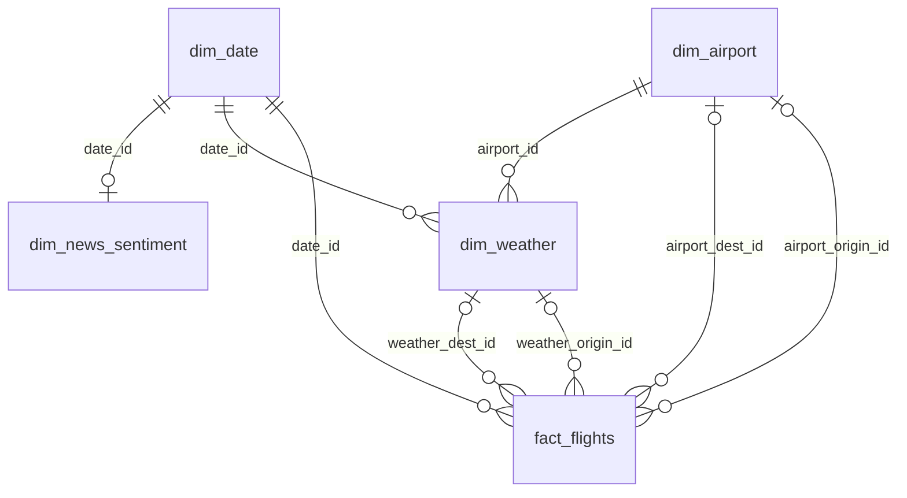

# Rendu 2 — Rapport d'organisation et de modélisation des données

> **Projet** : Airlines Delay Prediction — Titre RNCP 38919 (Data Engineer)
> **Statut** : Final
---

## 1. Architecture et stockage

### 1.1 Base de données choisie

**PostgreSQL** (système de gestion de base de données relationnel, client-serveur).

**Pourquoi PostgreSQL plutôt qu'une base embarquée ou une base NoSQL ?**
- **SGBD relationnel client-serveur mature et largement utilisé en entreprise** : PostgreSQL est un standard de l'industrie, avec un écosystème riche (extensions, outils d'administration, pilotes disponibles dans tous les langages), ce qui en fait un choix directement transférable à un contexte professionnel.
- **Disponible en local sans imposer le docker-compose applicatif** : en Phase 2, une instance PostgreSQL locale suffit (installation Windows, ou un conteneur `postgres:16` lancé isolément). Le `docker-compose` qui orchestre pipeline, API et base arrivent en Phase 4.
- **Compatibilité avec SQLAlchemy** : l'utilisation d'un toolkit SQL standard (SQLAlchemy) au-dessus de PostgreSQL facilite l'écriture de requêtes portables et la maintenance du code d'accès aux données.

PostgreSQL a été retenu à la place afin de démontrer une compétence de gestion de base de données client-serveur (connexion réseau, gestion de la concurrence), plus représentative des architectures rencontrées en environnement de production.

### 1.2 Choix d'architecture : Schéma en étoile

J'adopte un **schéma en étoile**, standard des Data Warehouses pour les cas d'usage analytiques/ML. `fact_flights` est au centre ; les dimensions gravitent autour.

L'exploration du Rendu 1 portait sur OpenSky `/states/all` (un avion à un instant). Ce n'est **pas** le grain de l'entrepôt. La table de faits est un vol `/flights/departure` ou `/flights/arrival` : un aéronef, une paire origine/destination, une fenêtre `first_seen` / `last_seen`.

Le schéma détaillé (colonnes, types, FK nommées) est versionné ainsi (aligné sur `src/database/schema.sql`) :

- `docs/erd_schema.png` — export PNG dbdiagram.io
- `docs/erd_schema.dbml` — source à recoller sur [dbdiagram.io](https://dbdiagram.io) si le DDL bouge
- `docs/erd_schema.md` — diagramme Mermaid
- `docs/erd_schema.svg` — diagramme vectoriel, ouvrable dans un navigateur

`dim_news_sentiment` n'a **pas** de FK `sentiment_id` sur `fact_flights` : la jointure se fait via `date_id`. `ingestion_log` est un journal technique, hors étoile.

**Pourquoi un schéma en étoile plutôt qu'une table unique, un flocon, un Data Lake ou une 3NF ?**

Les trois sources n'ont **pas le même grain** (déjà posé en conclusion du Rendu 1) :
- un **vol** OpenSky `/flights/*` : aéronef (`icao24`) + origine/destination + fenêtre `firstSeen` / `lastSeen` ;
- une **observation météo** OpenWeather : un hub + un instant ;
- un **article** NewsAPI : aucune clé vers un vol ; le grain utile est le jour (après agrégation).

**Vs. flocon (snowflake)** : le flocon normalise davantage les dimensions (ex : `dim_airport` éclatée en `dim_ville` + `dim_pays`), ce qui réduit la redondance mais complexifie les jointures. Vu le volume de mon projet (dix hubs, une vingtaine de milliers de vols, un signal d'actualité journalier), cette redondance est négligeable. Les requêtes restent simples, ce qui compte pour produire ensuite une table plate de features.

### 1.3 Table de faits et dimensions (détail)

| Table | Rôle | Colonnes clés (indicatif) |
|---|---|---|
| **fact_flights** | Table de faits — un enregistrement par vol observé (`/flights/*`, pas `/states/all`) | `flight_id`, `icao24`, `callsign`, `first_seen`, `last_seen`, `est_departure_airport`, `est_arrival_airport`, `date_id` (FK), `airport_origin_id` / `airport_dest_id` (FK, nullables hors hubs), `weather_origin_id` / `weather_dest_id` (FK, nullables), `retard_minutes` (nullable) |
| **dim_airport** | Dimension aéroport (IATA et ICAO : OpenWeather vs OpenSky) | `airport_id` (PK), `code_iata`, `code_icao` (UNIQUE), `ville`, `pays`, `latitude`, `longitude` |
| **dim_weather** | Dimension météo (rattachée à un hub + un instant UTC) | `weather_id` (PK), `airport_id` (FK), `date_id` (FK), `horodatage_observation`, température, `feels_like`, humidité, pression, vent, rafales, `rain_1h`, visibilité, `description_ciel` |
| **dim_news_sentiment** | Dimension sentiment des actualités (grain jour, jointure via `date_id`) | `sentiment_id` (PK), `date_id` (FK), `nb_articles`, `mots_cles`, `score_sentiment` (renseigné depuis la passe DistilBERT du 02/09/2026 ; NULL avant) |
| **dim_date** | Dimension temporelle (facilite les agrégations calendaires) | `date_id` (PK, YYYYMMDD), `date`, `jour_semaine`, `mois`, `est_ferie` |
| **ingestion_log** | Trace des chargements (rejeu / incrémental) | source, fichier, horodatages UTC, lignes lues / rejetées / insérées |

*(Le DDL est dans `src/database/schema.sql`)*

#### DDL as code

pgAdmin m'a servi à créer l'instance PostgreSQL locale et la base **vide** `airlines_db`. Les tables, clés et index ne sont pas cliqués dans l'interface : ils vivent dans `src/database/schema.sql`, appliqué par le connecteur (`executer_schema` dans `src/database/db_connector.py`). C'est du **DDL as code** : le même fichier recrée le schéma sur une autre machine, chez un binôme, ou plus tard dans un conteneur. pgAdmin inspecte ; il ne définit pas le contrat. L'ETL remplit ce contrat, il ne le remplace pas.

### 1.4 Comment les sources sont-elles reliées entre elles ?

Les sources se rejoignent par des **clés**, pas par une fusion à plat.
- **Vol → aéroport** : OpenSky parle ICAO (`LFPG`), OpenWeather est catalogué en IATA (`CDG`). `dim_airport` porte les deux. Hors des dix hubs, la FK reste nulle : c'est attendu.
- **Vol → météo** : observation la plus proche de `first_seen` (origine) ou `last_seen` (destination), écart max **3 heures**, sur un hub. Au-delà : `weather_*_id` NULL.
- **Vol → actualités** : `date_id` seulement. Pas de clé article↔vol. `score_sentiment` a été rempli en Phase 3 (DistilBERT) ; le DDL n'avait pas à l'attendre.
- **`retard_minutes`** : proxy nullable (durée vs médiane de route), pas un horaire "retard". 

**Effectif de référence (04/09/2026)** : 21 054 vols, 120 observations météo, 27 jours d'actualité, 3 664 lignes modèle. Les 172 / 972 vols d'août sont les premiers cycles.
Aucune page n'est scrapée : trois API REST. Les codes IATA sont dans `dim_airport`.

---

## 2. Documentation technique

### 2.1 Pipelines de données : ETL, code-based (Python)

Je choisis une approche **ETL code-based en Python** (par opposition à une approche déclarative type dbt/SQL) :

**Pourquoi Python plutôt que dbt ?**
- dbt est excellent pour transformer des données **déjà présentes dans un entrepôt SQL**. Ici, l'étape critique est l'**ingestion depuis des APIs externes hétérogènes** (JSON complexe, authentification, gestion d'erreurs réseau, appel à un modèle BERT) — un besoin procédural que Python gère nativement, alors que dbt n'est pas conçu pour appeler des APIs ou exécuter un modèle de NLP.
- Cohérence d'écosystème : un seul langage (Python) pour l'ingestion, la transformation ET le Machine Learning (Phase 3), ce qui simplifie la maintenance pour un projet solo.

**Logique du pipeline** :
1. **Extract** (`src/ingestion/` + `src/processing/collecter_hubs.py`) : appel des APIs, boucle hubs × `/flights/departure|arrival` avec pause, sauvegarde brute horodatée dans `data/raw/` (traçabilité et possibilité de rejouer les transformations sans réinterroger les APIs). NewsAPI n'est pas rappelée à chaque cycle.
2. **Transform** (`src/processing/`) : nettoyage (règles validées en Phase 1, adaptées au grain `/flights/*` pour les vols), normalisation, agrégation journalière des actualités. Le score BERT et le proxy de retard ne sont pas fabriqués « pour remplir la colonne » : `score_sentiment` et `retard_minutes` restent NULL tant que le calcul n'est pas défendable.
3. **Load** (`src/database/` + `src/processing/etl.py`) : écriture dans le schéma en étoile PostgreSQL, en upsert (`ON CONFLICT`) pour pouvoir relancer sans dupliquer. Ordre de chargement imposé par les FK : `dim_date` → `dim_airport` → `dim_weather` → `dim_news_sentiment` → `fact_flights`. Les faits référencent toutes les dimensions ; inverser l'ordre casserait les contraintes.

### 2.2 Outils, frameworks et technologies utilisés

| Catégorie | Outil | Justification courte |
|---|---|---|
| Langage | Python 3.11+ | Écosystème data/ML complet |
| Config & validation | Pydantic | Typage strict et validation des variables d'environnement au démarrage |
| HTTP | requests | Simplicité, standard de facto |
| Data | pandas | Manipulation tabulaire |
| NLP | transformers (HuggingFace) | DistilBERT en Phase 3 (`scorer_sentiment`) ; hors chemin critique de l'ETL quotidien |
| BDD | PostgreSQL | Voir le choix plus haut |
| Accès BDD | SQLAlchemy, psycopg2-binary | Toolkit SQL et pilote de connexion PostgreSQL pour Python |
| Profiling | ydata-profiling | Rapport de qualité automatisé (Rendu 1) |
| Tests | pytest | Standard Python, intégration CI/CD simple (Phase 4) |

---

## 3. Optimisation et fiabilité

### Quelles optimisations de performances sont mises en place ? (indexation, partitionnement, parallélisation, cache, etc.)

**Indexation** dans `schema.sql` : clés de jointure de `fact_flights`, `dim_weather` et `dim_news_sentiment`, plus l'index unique `uq_fact_flights_identite` (`icao24`, `first_seen`, aéroport de départ) qui sert à l'upsert `ON CONFLICT`.

Pas de **partitionnement** (21 054 vols au 04/09 : un découpage par date n'apporterait rien de lisible), pas de **parallélisation** (ETL et collecte séquentiels ; pause 9 s entre les appels OpenSky pour limiter les 429), pas de **cache** applicatif ni de Parquet. 

`data/raw/` sert au rejeu, pas à accélérer les lectures.

Je n'ai pas chronométré avant/après index : le goulot, c'est le calage météo ± 3 h et la reprise des hubs, pas l'index.

### Comment garantir la qualité et la cohérence des données ? (tests unitaires, validation de schéma, logs, monitoring)

**Tests** pytest (`tests/`) : plus de 140 tests (ingestion, schéma, ETL, modèle, API, Compose, DAG), fixtures JSON locales, pas de réseau ; une partie est ignorée si PostgreSQL n'est pas joignable.

**Rejet** en deux temps : `data_cleaning.py` (aéroports nuls, chronologie, doublons, `content` tronqué), puis contraintes SQL (FK, unicités, CHECK `last_seen >= first_seen`). 

Pydantic valide la **configuration** au démarrage, pas les payloads API. **Logs** : console + `logs/app.log` + table `ingestion_log`. Pas de monitoring d'entrepôt ici (pas de Prometheus sur PostgreSQL). Grafana, en Phase 4, scrape l'API, pas les vols.

### Mécanismes de mise à jour ou d'incrémentation automatique prévus

**Incrémental fichier, pas automatique.** Un JSON chargé avec succès est tracé dans `ingestion_log`. À la relance, l'ETL saute les fichiers déjà vus (chemin journalisé ou mtime) ; l'upsert `ON CONFLICT` évite les doublons si un fichier est relou. Ce n'est ni un filtre API « depuis le dernier timestamp », ni un scheduler : la collecte se lance à la main, NewsAPI n'est pas rappelée à chaque cycle. Après un 429, je reprends plus tard ; l'ETL n'a pas à recharger les JSON déjà réussis.

Airflow (DAG quotidien en pause) est dans le rapport final, une fois la cible calée. Jenkins / Terraform / Kubernetes : hors volumétrie et hors RAM de mon PC personnel (8 Go).

---